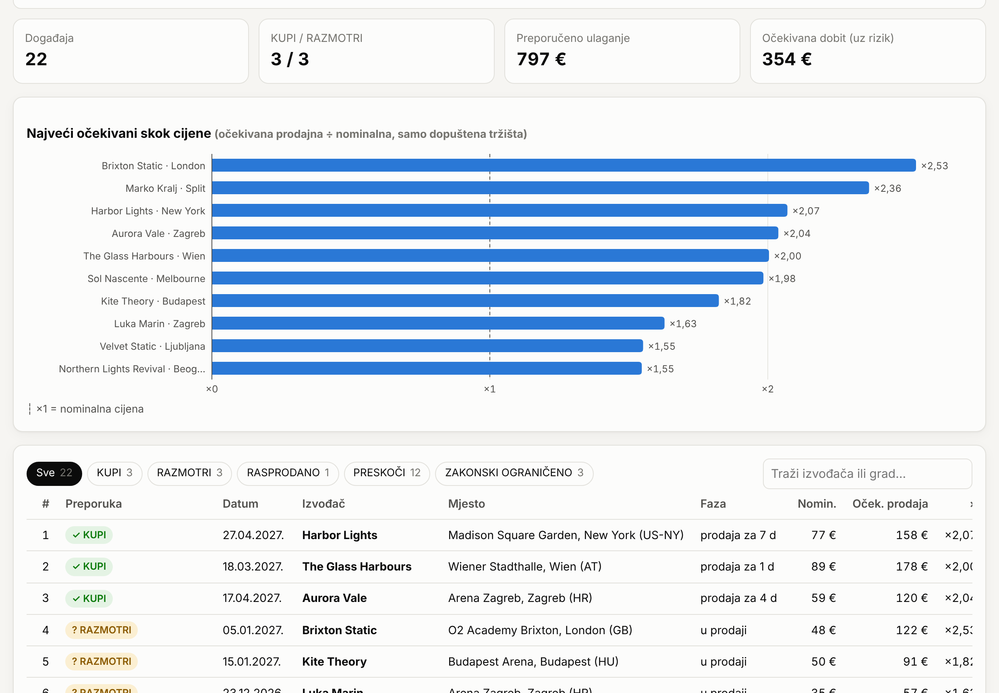
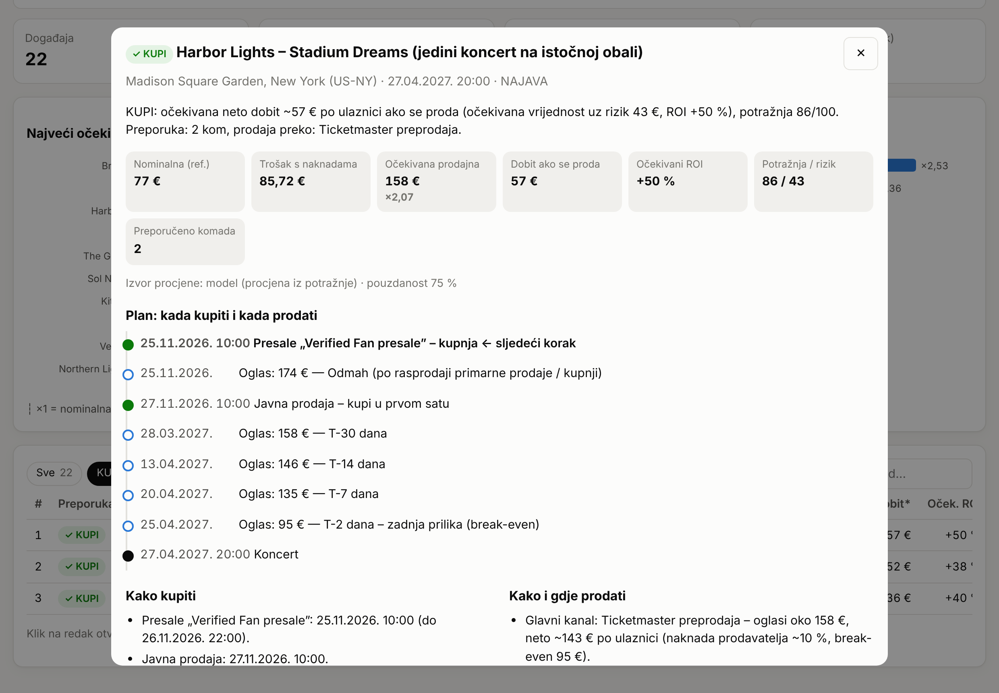

# karte — radar za preprodaju ulaznica 🎟️

Aplikacija koja **traži koncerte i sportske događaje bilo gdje u svijetu** u idućih 1–2 mjeseca (i događaje kojima **prodaja tek počinje**),
**procjenjuje potencijalnu zaradu** od preprodaje nakon svih naknada i rizika te za svaki događaj daje
**konkretan plan**: kako i kada kupiti, koju kategoriju i količinu, gdje prodati, po kojoj cijeni
i kako spuštati cijenu prema datumu događaja. Uz to provjerava **zakonska ograničenja** po državama i saveznim
državama/pokrajinama (SAD, Kanada, Australija…) te **može li prodavatelj iz Hrvatske uopće kupiti i prodati** na tom tržištu.

> ⚠️ Prije svega pročitaj [docs/ISTRAZIVANJE.md](docs/ISTRAZIVANJE.md) — iskrena analiza tržišta, platformi,
> zakona (Europa, SAD, Kanada, Australija, Azija, Latinska Amerika) i poreza. Ukratko: zarada postoji, ali je
> koncentrirana u malom broju događaja, naknade pojedu 25–35 %, a regulativa se u Europi i dijelu SAD-a postrožuje.

---

## Što aplikacija radi

| Korak | Opis |
|---|---|
| 1. Pretraga | Ticketmaster Discovery API (SAD, Kanada, Meksiko, Australija, NZ, UK, IE i većina Europe – ili cijeli svijet odjednom), SeatGeek (cijene sa sekundarnog tržišta), ručni CSV za Hrvatsku/regiju (Entrio, Eventim.hr, Ulaznice.hr nemaju javni API) |
| 2. Obogaćivanje | Last.fm popularnost izvođača, kapacitet dvorane (ugrađena baza), broj koncerata istog izvođača u državi (ponuda), veličina turneje |
| 3. Procjena | Potražnja (0–100), očekivana prodajna cijena, trošak kupnje s naknadama, neto isplata po platformi, vjerojatnost prodaje, očekivana vrijednost, ROI, rizik |
| 4. Pravna provjera | ~40 država + savezne države/pokrajine (US-VT, US-NC, CA-ON, CA-QC…): zabrane iznad nominalne (IE, BE, IT, PT, PL, NO, JP, KR, BR…), limit +10 % (AU, VT…), najavljeni limiti (DE, UK, DC) uz `--strict` |
| 4a. Sport i nogomet | Posebna pravila za nogomet (UK kazneno djelo, HR/DE/ES/NL uvjeti klubova, Italija, Francuska…) i natjecanja (UEFA, FIFA, NFL/NBA u Europi, F1); presuda **UVJETI ZABRANJUJU** + službeni kanal za povrat novca |
| 4b. Pristup tržištu | Može li prodavatelj iz HR prodavati na platformi (Vivid Seats/SeatGeek traže prebivalište u SAD-u), lokalni kanali u inozemstvu, rizik računa/isplata/valute |
| 5. Savjet | **KUPI / RAZMOTRI / PRESKOČI / RASPRODANO / ZAKONSKI OGRANIČENO** + plan kupnje (presale datumi), plan prodaje (platforme, cjenik po datumima), rizici |
| 6. Izvještaj | Terminal, HTML (sortabilna tablica, tamni način), Markdown, CSV, JSON; tjedno automatsko skeniranje preko GitHub Actions |
| 7. Grafičko sučelje | `karte gui` – sve gore navedeno u pregledniku + analiza kategorija, dnevnik prodaja s kalibracijom modela, plan po datumima i podsjetnici u kalendaru, vodiči |

## Brzi početak

```bash
git clone https://github.com/drobinho9/kartev2.git
cd kartev2
python3 -m venv .venv && source .venv/bin/activate     # Windows: .venv\Scripts\activate
pip install -e .

# Grafičko sučelje (otvara se u pregledniku na http://127.0.0.1:8765)
karte gui
```

## Grafičko sučelje (`karte gui`)

Najlakši način korištenja — sve radi lokalno na tvom računalu (server sluša samo na 127.0.0.1, podaci ostaju kod tebe).

| Kartica | Čemu služi |
|---|---|
| **Radar** | Odabereš regiju (ili cijeli svijet), dane i budžet → tablica preporuka (KUPI / RAZMOTRI / …), graf koncerata s najvećim očekivanim skokom cijene, filtri i sortiranje. Klik na koncert otvara **plan po datumima**: presale, javna prodaja, kada oglasiti i po kojoj cijeni, kada spuštati cijenu. Gumb **📅 Kalendar (.ics)** sve to doda u tvoj kalendar s podsjetnikom 30 min prije prodaje. |
| **Kalkulator** | Za jedan koncert (npr. s Entrija/Eventima) upišeš nominalnu cijenu i najnižu cijenu na viagogu → isplativost, platforme, cjenik. |
| **Kategorije** | **Koje ulaznice se najviše isplati preprodati** za isti koncert: parter, tribine, VIP, zaklonjena mjesta… rangirano po očekivanom ROI-ju i zaradi. |
| **Moje prodaje** | Dnevnik kupnji i prodaja (npr. tvoja **A$AP Rocky prodaja na viagogu** – gumb *Primjer*): dobit, ROI, koliko dana prije koncerta prodaješ, po platformi. Iz stvarnih prodaja **kalibrira model** i predlaže podešavanje. Uvoz/izvoz CSV. |
| **Tržišta** | Rang država za prodavača iz HR + pravila po državama i saveznim državama (US-VT, CA-ON…). |
| **Vodiči** | Virtualni redovi (kako najbolje doći do ulaznice), kada kupiti i prodati, viagogo korak po korak, koje karte se najviše preprodaju, **sigurna preprodaja bez kazni** (savjeti prodavača s foruma i iz pritužbi), **nogomet i sport** (kako klubovi prodaju ulaznice i gdje je preprodaja legalna). |





## Naredbeni redak

```bash
# 1) Isprobaj bez ikakvih ključeva (izmišljeni demo podaci)
karte scan --demo

# 2) HTML izvještaj
karte scan --demo --format html --out izvjestaj.html
```

Potreban je samo Python 3.11+ — aplikacija **nema vanjskih ovisnosti**.

> **Limiti API-ja kod globalnog skeniranja:** Ticketmaster vraća najviše 1000 rezultata po upitu, pa aplikacija sama dijeli
> razdoblje na manje dijelove (`svijet` za 60 dana ≈ nekoliko stotina poziva od 5000 dnevno). Last.fm se poziva samo za
> najperspektivnijih `--max-artists` izvođača (najprije oni s cijenom i najskupljim ulaznicama). Rezultati se cacheiraju 6 h.

### Pravi podaci (besplatni API ključevi)

```bash
cp .env.example .env     # upiši ključeve
karte doctor             # provjera ključeva
karte scan --days 60 --countries otvoreno --budget 1500 --format html --out izvjestaj.html
karte scan --countries svijet --days 45 --only KUPI,RAZMOTRI          # cijeli svijet
karte scan --countries sjeverna_amerika,GB --category mid             # regije i države zajedno
karte scan --vrsta sport --countries sjeverna_amerika                  # sport (NFL, NBA, MLB, NHL, MLS…)
```

### Gdje se isplati? Regije i rangiranje tržišta

```bash
karte markets --details     # rang država: veličina tržišta × legalnost × dostupnost iz HR
```

| Regija (`--countries`) | Države |
|---|---|
| `otvoreno` (zadano) | HR, SI, AT, HU, CZ, SK, DE, NL, SE, CH, GB, US, RS, BA — bez zakonskog limita i dostupno iz HR |
| `europa`, `zapadna_europa`, `srednja_europa`, `dach`, `benelux`, `nordijske`, `balkan` | europske skupine |
| `sjeverna_amerika`, `latam`, `oceanija`, `azija` | SAD/Kanada/Meksiko, Latinska Amerika, AU/NZ, Azija |
| `svijet` | sva Ticketmaster tržišta odjednom (bez filtra države) |

Države s limitom cijene i dalje se prikazuju, ali kao **ZAKONSKI OGRANIČENO**, pa vidiš i gdje *nemaš* što tražiti.

| Ključ | Gdje | Za što |
|---|---|---|
| `TICKETMASTER_API_KEY` | [developer.ticketmaster.com](https://developer.ticketmaster.com/) — odmah, besplatno, 5000 poziva/dan | Događaji, nominalne cijene, presale datumi, limit po kupcu |
| `LASTFM_API_KEY` | [last.fm/api/account/create](https://www.last.fm/api/account/create) — odmah, besplatno | Popularnost izvođača (signal potražnje) |
| `SEATGEEK_CLIENT_ID` | [seatgeek.com/account/develop](https://seatgeek.com/account/develop) — opcionalno | Cijene na sekundarnom tržištu (uglavnom SAD/UK) |

### Hrvatska i regija: ručni CSV

Ticketmaster ne pokriva HR/SI/RS/BA, a Entrio/Eventim.hr/Ulaznice.hr nemaju javni API. Zato događaje upisuješ
u CSV (Excel/Google Sheets → *Spremi kao CSV*) — najbolje **s najnižom cijenom koju vidiš na viagogu ili Njuškalu**,
jer je to najjači signal:

```bash
karte scan --csv primjeri/dogadaji.csv --countries HR
karte scan --csv primjeri/hr_watchlist_2026-11.csv --countries HR,AT,HU   # stvarni nadolazeći koncerti – dopuni cijene
```

Stupci (hrvatski ili engleski nazivi, razdjelnik `,` ili `;`):

| Stupac | Primjer | Napomena |
|---|---|---|
| `izvodjac`, `datum` | `Rod Stewart`, `2027-06-22` | **obavezno** (datum i kao `22.06.2027.`) |
| `naziv`, `dvorana`, `grad`, `drzava`, `vrijeme` | `Arena Pula`, `Pula`, `HR`, `21:00` | kapacitet poznatih dvorana se dopunjava sam |
| `cijena_min`, `cijena_max`, `valuta` | `45`, `95`, `EUR` | nominalne cijene (bez naknada) |
| `status` | `u prodaji` / `najava` / `rasprodano` / `odgođeno` / `otkazano` | |
| `prodaja_od`, `presale_naziv`, `presale_od` | `2026-12-05 10:00` | za događaje kojima prodaja tek počinje |
| `kapacitet`, `limit`, `personalizirano` | `7000`, `6`, `ne` | personalizirane ulaznice = veliki rizik |
| `oznake` | `farewell\|first_visit` | `farewell`, `reunion`, `first_visit`, `added_date`, `anniversary`, `regional_star`, `new_album` |
| `sek_najniza`, `sek_medijan`, `sek_izvor` | `140`, `190`, `ručno (viagogo)` | cijena koju vidi kupac; za Njuškalo upiši `Njuškalo` u `sek_izvor` |
| `slusatelji`, `prodavac`, `url`, `biljeske` | `1200000`, `eventim` | `prodavac`: `entrio`, `eventim`, `ulaznice_hr`, `ticketmaster` |

## Naredbe

```bash
karte scan [opcije]        # glavna pretraga i rangiranje
karte gui                  # grafičko sučelje u pregledniku
karte calc --face 59 --resale 140 --country HR --listeners 1500000 --capacity 16000   # brzi kalkulator za jedan događaj
karte kategorije --cat "Parter:59:parter" --cat "Tribina:79" --cat "VIP:189:vip" --venue "Arena Zagreb" --listeners 2000000
karte dnevnik              # statistika mojih prodaja (unos u: karte gui → Moje prodaje)
karte platforms --country US --vendor ticketmaster   # platforme, naknade, limiti, tko prima prodavatelje iz HR
karte laws [--country US-VT]   # pravila po državama i saveznim državama
karte markets --details        # rang tržišta za prodavača iz HR
karte sport --country HR       # nogomet: kako klubovi prodaju ulaznice i što je dopušteno
karte doctor                   # provjera API ključeva
```

Najvažnije opcije za `scan`:

| Opcija | Zadano | Opis |
|---|---|---|
| `--days N` | 60 | koncerti koji se održavaju u idućih N dana |
| `--onsale-days N` | 30 | + koncerti (do 12 mj. unaprijed) kojima prodaja počinje u idućih N dana — **ovdje je najveća prilika** |
| `--countries` | `otvoreno` | ISO kodovi i/ili regije, npr. `US,GB,DE`, `europa`, `svijet` |
| `--seller-country` | `HR` | tvoje prebivalište – koje platforme te primaju i rizik pristupa |
| `--max-artists` | 300 | koliko najperspektivnijih izvođača obogatiti Last.fm-om (bitno za `svijet`) |
| `--show-all` | isključeno | prikaži i događaje bez nominalne cijene u izvoru |
| `--vrsta` | `koncerti` | `koncerti`, `sport` ili `sve` |
| `--budget` | 1000 | ukupni budžet; u jedan događaj ide najviše 25 % |
| `--category` | `cheap` | `cheap` / `mid` / `premium` — koju kategoriju ciljaš |
| `--strict` | isključeno | primijeni i najavljene limite (DE +20 %/max +20 €, UK nominalna cijena) |
| `--csv FILE` | — | dodaj ručne događaje (može više puta) |
| `--only KUPI,RAZMOTRI` | — | filtriraj preporuke |
| `--model FILE` | — | vlastiti parametri modela ([docs/MODEL.md](docs/MODEL.md)) |
| `--format` / `--out` | `table` | `table`, `html`, `md`, `csv`, `json` |

## Automatsko skeniranje na GitHubu

Workflow [`.github/workflows/scan.yml`](.github/workflows/scan.yml) pokreće skeniranje svakog **ponedjeljka i četvrtka**
(i ručno: *Actions → Tjedni radar ulaznica → Run workflow*). Izvještaji (HTML/MD/CSV/JSON) se spremaju kao *artifact*,
a sažetak preporuka KUPI/RAZMOTRI vidi se izravno na stranici izvođenja.

1. *Settings → Secrets and variables → Actions → New repository secret*: `TICKETMASTER_API_KEY`, `LASTFM_API_KEY` (opcionalno `SEATGEEK_CLIENT_ID`).
2. Za svoje HR događaje dodaj `primjeri/moji_dogadaji.csv` — workflow ga automatski uključuje.

## Kako se računa isplativost (ukratko)

```
trošak        = nominalna × (1 + naknada kupnje) + fiksna naknada
oček. prodaja = nominalna × multiplikator        (iz stvarnih oglasa ako postoje, inače iz potražnje)
neto          = min(oček. prodaja × faktor platforme, zakonski/platformski limit) × (1 − naknada prodavatelja)
oček. vrij.   = P(prodaja) × neto + (1 − P) × prodaja u bescjenje − trošak
ROI           = oček. vrij. / trošak
```

**KUPI** = ROI ≥ 30 %, potražnja ≥ 60, rizik ≤ 50. **RAZMOTRI** = ROI ≥ 10 %. Sve je objašnjeno i podesivo u
[docs/MODEL.md](docs/MODEL.md) i `karte/data/model.toml`.

## Dokumentacija

- 📊 [docs/ISTRAZIVANJE.md](docs/ISTRAZIVANJE.md) — tržište, platforme i naknade, zakoni po državama, porezi u HR, slični projekti i alati, izvori podataka
- 🧭 [docs/STRATEGIJA.md](docs/STRATEGIJA.md) — praktični priručnik: odabir događaja, kupnja, prodaja, cijene, rizik, porezi
- 🧮 [docs/MODEL.md](docs/MODEL.md) — kako model radi i kako ga kalibrirati vlastitim podacima
- 🎫 Vodiči (i u kartici *Vodiči*): [virtualni redovi](karte/data/guides/1_redovi.md) · [kada kupiti/prodati](karte/data/guides/2_kada_kupiti_prodati.md) · [viagogo za prodavatelje](karte/data/guides/3_viagogo.md) · [koje karte se najviše preprodaju](karte/data/guides/4_koje_karte.md) · [**sigurna preprodaja bez kazni**](karte/data/guides/5_sigurnost.md) · [**nogomet i sport**](karte/data/guides/6_nogomet_sport.md)

## Struktura projekta

```
karte/
  cli.py            naredbe
  pipeline.py       dohvat → spajanje → obogaćivanje → procjena
  scoring.py        model potražnje, cijene, rizika i preporuke
  advisor.py        savjeti: kupnja, prodaja, cjenik
  categories.py     analiza kategorija (koje ulaznice se najisplativije preprodaju)
  journal.py        dnevnik kupnji/prodaja, statistika, kalibracija modela
  service.py        zajednički sloj za CLI i sučelje
  gui/              lokalni web server + sučelje (HTML/CSS/JS, bez vanjskih biblioteka)
  legal.py          pravila po državama i saveznim državama/pokrajinama
  sport.py          sport/nogomet: prepoznavanje sporta i natjecanja, posebna pravila (sport.toml)
  platforms.py      platforme za preprodaju i naknade
  report.py         terminal / HTML / Markdown / CSV / JSON
  providers/        ticketmaster, seatgeek, lastfm, manual (CSV), demo
  data/             laws.toml, markets.toml (regije, pristup), platforms.toml, venues.toml, model.toml, demo_events.json, guides/
primjeri/           primjeri CSV-a (uklj. stvarnu HR watchlistu)
docs/               istraživanje, strategija, model
tests/              pytest (bez mreže)
```

Testovi: `pip install -e ".[dev]" && pytest`

## Pravila igre (važno)

- **Bez botova i bez zaobilaženja limita** (više lažnih računa, tuđi računi). U EU je preprodaja tako kupljenih
  ulaznica zabranjena (Omnibus direktiva; u HR Zakon o zaštiti potrošača, NN 19/22). Aplikacija namjerno **ne** automatizira kupnju.
- **Ne prodaj ono što nemaš** (spekulativni oglasi) i ne prodaj istu ulaznicu više puta.
- Poštuj zakone države (i savezne države) događaja — aplikacija označava mjesta s limitom cijene kao *ZAKONSKI OGRANIČENO*.
- Sustavna preprodaja radi zarade je **gospodarska djelatnost** (obrt/porez), a platforme prijavljuju prodavatelje poreznoj upravi (DAC7).
- Ništa ovdje nije financijski ni pravni savjet; naknade i propisi se mijenjaju — provjeri prije kupnje.

Licenca: MIT
